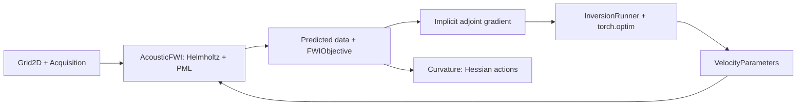
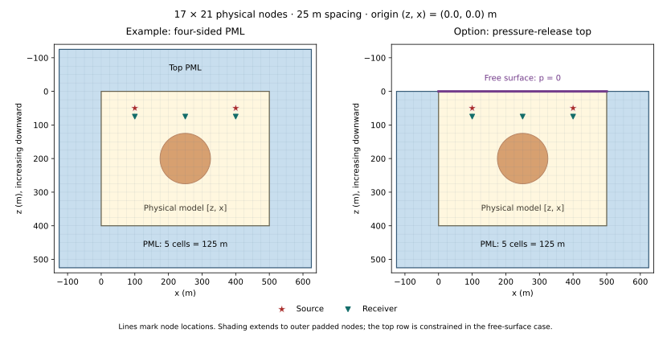

# SimpleFWI

[MIT License](LICENSE) · [Tutorial notebooks](notebooks/README.md)

SimpleFWI provides two-dimensional, constant-density acoustic frequency-domain
full waveform inversion through PyTorch. The `simplefwi.fwi2d` API combines
explicit SI geometry, complex Helmholtz solves, implicit adjoint gradients,
native optimizers, and operator-based curvature. Start with the CPU sparse-direct
reference solver and a small synthetic experiment before increasing resolution.

Models use metres and metres/second, with arrays ordered **[z, x]** and an explicit
first-node origin. Data use **[frequency, source, receiver]**; frequencies are
positive Hz. Default precision is float64 for real parameters and complex128 for
wavefields, with Fourier convention `exp(-i omega t)`.



The optimizer receives the physical gradient through the bounded velocity
parameterization. Source batches are processed sequentially; increasing survey
size still increases stored data and can increase native optimizer state.

Use **Python 3.12** and released **PyTorch 2.12.0**. From a checkout, install the
CPU wheel first, then the resolved dependencies and editable package:

```bash
python3.12 -m venv .venv
source .venv/bin/activate
python -m pip install torch==2.12.0 --index-url https://download.pytorch.org/whl/cpu
python -m pip install -r requirements/fwi2d-py312.lock
python -m pip install --no-deps -e '.[fwi2d]'
```

For NVIDIA GPUs, first install the **2.12.0** CUDA wheel selected by the
[official PyTorch installer](https://pytorch.org/get-started/locally/) for your
driver; then run the last two installation commands. Request
`SolverConfig(method='fgmres', device='cuda')` explicitly and move input tensors
to that device. CUDA execution remains unvalidated in this release; installation
does not establish numerical compatibility. See the
[device and optimizer matrix](guides/optimizers.md).

Three illustrated, executable tutorials cover the public API:

| Tutorial | What you will learn |
| --- | --- |
| [Helmholtz on CPU and GPU](notebooks/01_helmholtz_marmousi_cpu_gpu.ipynb) | Marmousi, PML, wavefields, residuals, and device comparisons |
| [FWI with three optimizers](notebooks/02_fwi_marmousi_optimizers.ipynb) | Adam, RMSprop, and L-BFGS with comparable objectives and measured work |
| [Hessians and uncertainty](notebooks/03_camembert_hessian_uncertainty.ipynb) | Camembert, exact/Gauss–Newton curvature, proper priors, and local covariance |

See the [notebook guide](notebooks/README.md) for setup, execution, and scope.
For coarse-to-fine grids and low-to-high frequency stages, see
[multi-resolution and multi-frequency FWI](guides/multiscale.md) and its runnable
Marmousi example. Each stage uses a fresh native optimizer and preserves physical
acquisition coordinates.

This small Camembert smoke example creates a circular velocity inclusion,
simulates two sources, and accepts one native Adam step. It uses same-grid
synthetic data to check integration; it does not establish reconstruction accuracy.
Run it in a fresh working directory:

```python
import json
import math
import torch
from simplefwi.fwi2d import (
    AcousticFWI, Acquisition, BoundaryConfig, Grid2D,
    InversionRunner, SolverConfig, VelocityParameters,
)

grid = Grid2D((17, 21), (25., 25.), origin_m=(0., 0.))
boundary = BoundaryConfig(top='pml', pml_cells=5)
acquisition = Acquisition(
    sources_m=((50., 100.), (50., 400.)),
    receivers_m=((75., 100.), (75., 250.), (75., 400.)),
)
z = torch.arange(grid.shape[0], dtype=torch.float64) * grid.spacing_m[0]
x = torch.arange(grid.shape[1], dtype=torch.float64) * grid.spacing_m[1]
inside = (z[:, None] - 200.)**2 + (x[None, :] - 250.)**2 <= 75.**2
initial = torch.full(grid.shape, 1500., dtype=torch.float64)
truth = torch.where(inside, 1650., initial)
fwi = AcousticFWI(grid, acquisition, boundary, SolverConfig())
observed = fwi.simulate(truth, (2.,), source_batch_size=1)
objective = fwi.objective(observed, (2.,))
model = VelocityParameters(initial, (1400., 1800.))
before = model.velocity().detach().clone()
optimizer = torch.optim.Adam(model.parameters(), lr=0.01)
runner = InversionRunner(objective, model, optimizer, source_batch_size=1)
step = runner.step()
torch.save({'velocity': model.velocity().detach(), 'data': observed}, 'quickstart.pt')
print(json.dumps({
    'accepted_steps': runner.accepted_steps, 'loss': step.loss,
    'data_shape': list(observed.shape),
    'finite_data': bool(torch.isfinite(observed).all()),
    'finite_loss': math.isfinite(step.loss),
    'closure_evaluations': step.closure_evaluations,
    'model_changed': not torch.equal(before, model.velocity().detach()),
}))
```



The illustration uses the example's grid and acquisition. Its right panel changes
only `top='free_surface'`: pressure is zero along the physical top, with no top
padding. Side and bottom PML remain. The five-cell padding is illustrative;
accuracy studies must validate PML thickness, spacing, and frequency together.

See the [implementation status](guides/implementation-status.md). Continue with the [quickstart](guides/quickstart.md),
[architecture and source units](guides/architecture.md),
[matrix-free Hessians and uncertainty](guides/uncertainty.md), and
[accepted-state output and restart](guides/outputs.md).
[Accuracy guidance](guides/accuracy.md) distinguishes screening from physical
validation. CPU tests cover solver residuals, derivatives, optimizer integration,
and restart. Local iterative timings were worse than direct solves, and some
high-frequency cases failed convergence; no GPU speedup is established.

Run `python -m pytest tests/fwi2d -q` for the new implementation.
[Validation evidence and limitations](guides/validation.md) include unrun CUDA
checks and pre-existing legacy full-collection failures. Existing legacy entry
points remain available; use the [migration guide](guides/migration.md).
SimpleFWI is [MIT licensed](LICENSE). Attribute the
[project and contributors](https://github.com/izzatum/SimpleFWI); no associated
publication is claimed here.
