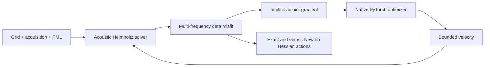

# SimpleFWI — 2D Full-Waveform Inversion in PyTorch

[Documentation](guides/architecture.md) · [Quickstart](#quickstart) · [Tutorials](notebooks/README.md) · [Validation](guides/validation.md) · [Citation](CITATION.cff) · [MIT License](LICENSE)

**SimpleFWI is an open-source Python library for 2D full-waveform inversion
(FWI) in PyTorch.** It estimates acoustic velocity by matching modeled and
observed seismic data in the frequency domain. The `simplefwi.fwi2d` API provides
a constant-density Helmholtz solver with perfectly matched layers (PML),
implicit adjoint gradients, multi-frequency inversion, and Hessian-vector
products for local uncertainty studies. Start with the CPU sparse-direct
reference solver and the examples below; the experimental CUDA solver has
separate [hardware validation](benchmarks/fwi2d/results/runpod-multiscale.json).

## Capabilities

- **Acoustic wave modeling:** conservative second-order Helmholtz operator,
  perfectly matched layers (PML), and an optional pressure-release free surface.
- **Multi-resolution and multi-frequency FWI:** coarse-to-fine grids and
  low-to-high frequency bands, with physical squared-slowness transfer, fixed
  acquisition coordinates, and fresh optimizer state at every stage.
- **Native PyTorch optimizers:** 15 tested CPU recipes, including Adam, RMSprop,
  L-BFGS, Muon, and SparseAdam, with explicit active masks and bounded velocities.
- **Curvature and local uncertainty:** matrix-free exact Hessian and
  Gauss–Newton actions in physical or dense parameter coordinates, plus
  proper-prior local covariance tools.
- **Reproducible experiments:** source-batched gradients, accepted-state HDF5
  recording, restart checkpoints, dispersion screening, and Marmousi/Camembert
  examples with recorded configuration and provenance.

Models use SI units: metres, metres/second, and Hz. Model arrays are **[z, x]**
with an explicit first-node origin; data are **[frequency, source, receiver]**.
Defaults are float64 parameters and complex128 fields with `exp(-i omega t)`.



## Installation

The validated environment uses **Python 3.12 and PyTorch 2.12.0**. From a checkout:

```bash
python3.12 -m venv .venv
source .venv/bin/activate
python -m pip install torch==2.12.0 --index-url https://download.pytorch.org/whl/cpu
python -m pip install -r requirements/fwi2d-py312.lock
python -m pip install --no-deps -e '.[fwi2d]'
```

For NVIDIA CUDA, use a separate environment and replace the CPU wheel command
with the **PyTorch 2.12.0 CUDA wheel** appropriate for your driver from the
[official PyTorch installer](https://pytorch.org/get-started/locally/). Then run
the same dependency and editable-install commands. The legacy `gpu-cuda` extra
is not the installation path for this PyTorch solver. See the
[installation guide](guides/quickstart.md) and [optimizer constraints](guides/optimizers.md).

## Quickstart

This complete CPU example simulates a circular velocity inclusion and accepts
one Adam step. Run it in a fresh working directory; it writes `quickstart.pt`.
Same-grid synthetic observations make this an integration check, not evidence
of recovered geology after one step.

```python
import json
import math
import torch
from simplefwi.fwi2d import (
    AcousticFWI, Acquisition, BoundaryConfig, Grid2D,
    InversionRunner, SolverConfig, VelocityParameters,
)

grid = Grid2D((17, 21), (25., 25.), origin_m=(0., 0.))
boundary = BoundaryConfig(top='pml', pml_cells=5)
acquisition = Acquisition(
    sources_m=((50., 100.), (50., 400.)),
    receivers_m=((75., 100.), (75., 250.), (75., 400.)),
)
z = torch.arange(grid.shape[0], dtype=torch.float64) * grid.spacing_m[0]
x = torch.arange(grid.shape[1], dtype=torch.float64) * grid.spacing_m[1]
inside = (z[:, None] - 200.)**2 + (x[None, :] - 250.)**2 <= 75.**2
initial = torch.full(grid.shape, 1500., dtype=torch.float64)
truth = torch.where(inside, 1650., initial)
fwi = AcousticFWI(grid, acquisition, boundary, SolverConfig())
observed = fwi.simulate(truth, (2.,), source_batch_size=1)
objective = fwi.objective(observed, (2.,))
model = VelocityParameters(initial, (1400., 1800.))
before = model.velocity().detach().clone()
optimizer = torch.optim.Adam(model.parameters(), lr=0.01)
runner = InversionRunner(objective, model, optimizer, source_batch_size=1)
step = runner.step()
torch.save({'velocity': model.velocity().detach(), 'data': observed}, 'quickstart.pt')
print(json.dumps({
    'accepted_steps': runner.accepted_steps, 'loss': step.loss,
    'data_shape': list(observed.shape),
    'finite_data': bool(torch.isfinite(observed).all()),
    'finite_loss': math.isfinite(step.loss),
    'closure_evaluations': step.closure_evaluations,
    'model_changed': not torch.equal(before, model.velocity().detach()),
}))
```


The illustration matches the example geometry. Changing only
`top='free_surface'` sets pressure to zero at the physical top and retains side
and bottom PML. The five-cell layer is illustrative; validate PML thickness,
grid spacing, and frequency together before an accuracy study.

## Run multi-resolution and multi-frequency inversion

From the checkout, the Marmousi example runs coarse 2 Hz, fine 2 Hz, and fine
joint 2/3 Hz stages:

```bash
OPENBLAS_NUM_THREADS=1 OMP_NUM_THREADS=1 python examples/fwi2d/multiscale_marmousi.py \
  --device cpu --quick --output /tmp/multiscale-cpu.json
```

On an installed CUDA environment with an actual NVIDIA GPU:

```bash
python -c "import torch; assert torch.cuda.is_available(), 'CUDA device required'"
OPENBLAS_NUM_THREADS=1 OMP_NUM_THREADS=1 python -m pytest tests/fwi2d -m cuda -q -rs
OPENBLAS_NUM_THREADS=1 OMP_NUM_THREADS=1 python examples/fwi2d/multiscale_marmousi.py \
  --device cuda --quick --output /tmp/multiscale-cuda.json
```

CUDA uses the experimental matrix-free FGMRES path. Device, precision and
residual tolerances are explicit; unavailable CUDA does not silently fall back
to CPU. **All 10 CUDA tests passed on an NVIDIA A40** with PyTorch 2.12.0 and
CUDA 13. See the [hardware validation record](benchmarks/fwi2d/results/runpod-multiscale.json)
for executed cases and limits. No GPU speedup is established.

The [multiscale guide](guides/multiscale.md) explains stage schedules, immutable
observations, PML widths, physical priors, masks, optimizer/scheduler resets and
stage-local recording. Losses from different frequency bands are different
objectives: assess reduction within each stage.

## Tutorials and documentation

| Start here | Topics |
| --- | --- |
| [Helmholtz modeling notebook](notebooks/01_helmholtz_marmousi_cpu_gpu.ipynb) | Marmousi, PML, wavefields, residuals, and explicit CPU/CUDA comparisons |
| [FWI optimizer notebook](notebooks/02_fwi_marmousi_optimizers.ipynb) | Adam, RMSprop, L-BFGS, loss histories and measured computational work |
| [Hessian and uncertainty notebook](notebooks/03_camembert_hessian_uncertainty.ipynb) | Exact/Gauss–Newton curvature, proper priors and local covariance |
| [Accuracy and validation](guides/accuracy.md) | Dispersion screening, physical calibration and numerical error |
| [Recording and restart](guides/outputs.md) | Accepted models, bounded HDF5 output and native-state checkpoints |
| [Architecture](guides/architecture.md) · [Migration](guides/migration.md) | SI conventions, solver design and legacy API compatibility |

The [notebook guide](notebooks/README.md) covers installation and execution.
All three default notebooks have executed on CPU: 30 code cells and 16 saved
figures. The Helmholtz notebook also passed a separate A40 CUDA execution;
its saved illustrations retain the reviewed CPU run. See
[implementation status](guides/implementation-status.md) for delivered features
and outstanding work.

## Validation and limitations

The [recorded CPU run](benchmarks/fwi2d/results/multiscale-cpu.json) at revision
`abbfe1f` reports **463 passed, zero failures/errors/skips, and 10 CUDA tests
deselected**. Reproduce the CPU selection with:

```bash
OPENBLAS_NUM_THREADS=1 OMP_NUM_THREADS=1 python -m pytest tests/fwi2d -m 'not cuda' -q
```

CPU checks cover solver residuals, adjoints and second derivatives, physics
fixtures, all 15 optimizer recipes, multiscale transfer and lifecycle, recording,
and restart. A separate A40 run executed all **10 CUDA tests with zero failures,
errors or skips**, including multiscale PML/free-surface parity and bounded
recording. The CPU artifact's deselections are separate from this hardware result.
Matched three-stage Marmousi crop runs reduced data misfit within every stage;
the six CPU/GPU initial/final losses agreed within **6.22e-10 relative error**.

The small Marmousi continuation examples use synthetic fine-grid observations
and short, uncalibrated PML. Model RMSE did not improve in this short run, despite
lower data misfit. These examples establish workflow integration; full-model
reconstruction, independent continuum accuracy and high-frequency scaling remain
unverified.
Historical CPU FGMRES timings were worse than sparse-direct solves, and some
harder cases failed convergence. A small linear residual or passed dispersion
screen alone does not prove physical accuracy. The
[validation guide](guides/validation.md) records these limits and pre-existing
legacy full-repository pytest collection failures; the CPU result above applies
to `tests/fwi2d`, not the entire legacy repository.

## Frequently asked questions

**What is 2D full-waveform inversion?** FWI estimates subsurface properties by
minimizing the difference between simulated and observed wave data. SimpleFWI
estimates a two-dimensional acoustic velocity model using frequency-domain
data. It does not implement 3D, elastic, or variable-density inversion.

**How does the Helmholtz solver handle boundaries?** A padded perfectly matched
layer (PML) uses complex coordinate stretching to absorb outgoing waves. An
optional pressure-release free surface replaces the top PML; side and bottom
PML remain. See the [solver architecture](guides/architecture.md) and
[accuracy guide](guides/accuracy.md).

**How do multi-resolution and multi-frequency FWI differ?** Multi-resolution
changes the grid; multi-frequency continuation changes the frequencies included
in the objective. SimpleFWI schedules either or both and transfers physical
`m = 1 / velocity**2` between refined grids.

**Can SimpleFWI run full-waveform inversion on a GPU?** Yes. The CUDA FGMRES path
has passed 10 numerical tests on an NVIDIA A40, including small inversion and
multiscale comparisons. Full-model high-frequency scaling remains unestablished;
CPU sparse-direct solves remain the reference default.

**Does SimpleFWI compute a Hessian?** It provides exact and Gauss–Newton
Hessian-vector products without assembling a dense Hessian. Local uncertainty
also requires declared noise scaling, parameter coordinates and a proper prior;
see the [curvature and uncertainty guide](guides/uncertainty.md).

## Citation and license

Use the repository's **Cite this repository** menu or [CITATION.cff](CITATION.cff)
for software attribution. Record the exact commit, configuration and data
provenance so others can reproduce your result; no associated publication or
DOI is claimed. The code is [MIT licensed](LICENSE). Retain the license notice
when redistributing it; check model-data provenance separately.

Maintainers: [Documentation publishing](website/README.md) ·
[Search visibility and indexing](guides/search-visibility.md).
